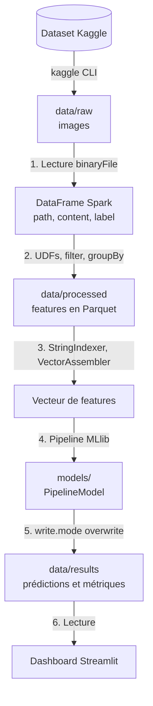

# Détection de deepfakes avec PySpark

Pipeline batch de bout en bout qui classe une image comme **réelle** ou **deepfake** : lecture, transformations, feature engineering, entraînement avec Spark MLlib, écriture des prédictions et visualisation dans un dashboard Streamlit.

> **État du projet :** ce README décrit l'architecture cible. Les fichiers de `src/` et `dashboard/` restent à implémenter.

## Dataset

| | |
|---|---|
| Source | [Kaggle : `shaikakram67/deepfake`](https://www.kaggle.com/datasets/shaikakram67/deepfake) |
| Type | Images |
| Tâche | Classification binaire : image réelle ou deepfake |
| Volume, répartition des classes, licence | À compléter après téléchargement |

Le pipeline suppose que la classe se déduit du nom d'un dossier parent (par exemple `real/` ou `fake/`). **Cette arborescence est à vérifier sur les fichiers téléchargés.**

## Architecture

### Flux de données



### Étapes du pipeline

| Étape | Module | Contenu | Sortie |
|---|---|---|---|
| 1. Lecture | `src/ingestion.py` | `SparkSession`, `spark.read.format("binaryFile")`, label tiré du chemin | DataFrame d'images |
| 2. Transformations | `src/transformations.py` | UDFs de décodage et d'extraction, `withColumn`, `filter` des images illisibles, doublons retirés par empreinte du contenu, `groupBy` par classe | `data/processed/` |
| 3. Feature engineering | `src/features.py` | `StringIndexer`, `VectorAssembler`, `StandardScaler`, `Pipeline` | Définition du pipeline |
| 4. Machine learning | `src/train.py` | Régression logistique (référence), Random Forest, GBT ; validation croisée | `models/` |
| 5. Écriture | `src/export.py` | Parquet via `write.mode("overwrite")` | `data/results/` |
| 6. Visualisation | `dashboard/app.py` | Lecture des résultats avec pandas / PyArrow | Dashboard web |

La lecture passe par `binaryFile`, et non par `read.csv`, parce que les données sont des images. Les résultats sont ensuite stockés en Parquet.

### Features extraites des images

| Famille | Features | Intérêt |
|---|---|---|
| Géométrie et fichier | largeur, hauteur, ratio, taille en octets | Contrôle de qualité des données |
| Couleur | moyenne et écart-type par canal RGB, saturation | Incohérences colorimétriques |
| Texture | variance du laplacien, densité de contours | Lissage artificiel |
| Fréquences | part d'énergie en hautes fréquences (FFT) | Artefacts de génération |
| Compression | statistiques d'*Error Level Analysis* | Traces de retouche |

> **Risque de biais :** si les images réelles et fausses diffèrent par leur résolution ou leur format, le modèle peut apprendre la source plutôt que le deepfake. Comparer ces attributs par classe, redimensionner les images à une taille commune avant le calcul des features visuelles, et exclure la géométrie et la taille de fichier de l'entraînement.

### Évaluation du modèle

- Découpage train / test avec graine fixe (80 / 20), ou découpage fourni par le dataset s'il existe.
- Déduplication avant le découpage pour éviter les fuites de données.
- Métriques : AUC ROC, F1, précision, rappel, matrice de confusion.
- Le meilleur modèle est sauvegardé avec `PipelineModel.write().overwrite().save(...)`.

### Dashboard

- Répartition des classes réelles et prédites.
- Métriques et matrice de confusion.
- Liste filtrable des prédictions avec leur probabilité.
- Aperçu des images mal classées.

## Structure du dépôt

```text
deepfake-detection/
├── README.md
├── requirements.txt
├── .gitignore
├── data/                  # non versionné
│   ├── raw/
│   ├── processed/
│   └── results/
├── models/                # non versionné
├── src/
│   ├── __init__.py
│   ├── config.py          # chemins, graine, paramètres Spark
│   ├── main.py            # enchaîne les étapes 1 à 5
│   ├── ingestion.py
│   ├── transformations.py
│   ├── features.py
│   ├── train.py
│   └── export.py
├── dashboard/
│   └── app.py
└── reports/
    └── rapport.pdf        # 5 pages maximum
```

## Dépendances

### Système

| Outil | Version |
|---|---|
| Python | 3.11 ou plus (3.12 conseillé) |
| Java (JDK) | 17 ou 21, avec `JAVA_HOME` défini |
| Git | version récente |

Sous Windows, il est conseillé d'exécuter le projet dans WSL2 : Spark en natif demande une configuration supplémentaire (`winutils.exe`, `HADOOP_HOME`).

### Python (`requirements.txt`)

| Paquet | Version | Rôle |
|---|---|---|
| `pyspark[sql,ml]` | 4.3.0 | Traitement des données et MLlib |
| `pandas` | ≥ 2.2, < 3 | UDFs pandas et dashboard |
| `pyarrow` | ≥ 18 | Parquet et échanges Spark / Python |
| `numpy` | ≥ 1.26, < 3 | Calcul des features |
| `pillow` | ≥ 11 | Décodage des images |
| `streamlit` | ≥ 1.50 | Dashboard |
| `plotly` | ≥ 6 | Graphiques |
| `kaggle` | ≥ 2.0 | Téléchargement du dataset |

Le modèle est entraîné avec MLlib, scikit-learn n'est donc pas nécessaire.

## Installation

```bash
git clone <URL_DU_DEPOT>
cd deepfake-detection

python -m venv .venv
source .venv/bin/activate        # Windows : .venv\Scripts\activate
pip install -r requirements.txt

java -version                    # doit afficher 17 ou 21
```

### Télécharger les données

1. Sur Kaggle, créer un jeton d'API (*Settings → API*) et le configurer comme indiqué sur la page.
2. Lancer :

```bash
kaggle datasets download -d shaikakram67/deepfake -p data/raw --unzip
```

Ne jamais versionner le jeton Kaggle. Le `.gitignore` doit contenir :

```gitignore
.venv/
data/
models/
__pycache__/
kaggle.json
.env
```

## Exécution

Une fois les modules implémentés :

```bash
# Étapes 1 à 5 en une seule commande
python -m src.main

# Étape 6 : dashboard sur http://localhost:8501
streamlit run dashboard/app.py
```

## Livrables et notation (60 % de la note finale)

| Critère | Poids | Où dans le projet |
|---|---|---|
| Qualité du pipeline PySpark | 30 % | `src/` |
| UDFs et feature engineering | 20 % | `src/transformations.py`, `src/features.py` |
| Modèle ML et évaluation | 20 % | `src/train.py`, `models/` |
| Dashboard Streamlit | 20 % | `dashboard/app.py` |
| Rapport technique | 10 % | `reports/rapport.pdf` |

## Résultats

| Modèle | AUC ROC | F1 | Précision | Rappel |
|---|---|---|---|---|
| Régression logistique | à compléter | | | |
| Random Forest | à compléter | | | |
| GBT | à compléter | | | |

## Auteurs

À compléter.